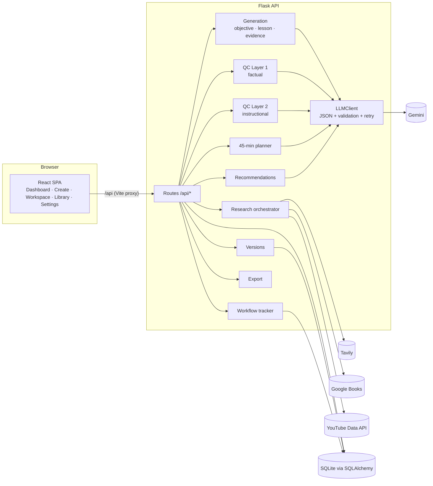

# LessonForge

**Research. Generate. Verify. Teach.**

LessonForge turns a lesson title and learning objective into a structured, research-backed lesson that fits in **45 minutes or less**. It researches websites, books and YouTube videos, writes the lesson with **claim-level evidence links**, checks every quoted excerpt against the retrieved source text, and audits the result with **two independent AI quality checks**. Instructors can then review, edit, version, finalize and export the lesson.

> Built as a locally runnable full-stack application: React + TypeScript + Tailwind frontend, Flask + SQLAlchemy + SQLite backend, Gemini for AI, Tavily / Google Books / YouTube Data API for research.

---

## Contents
- [Problem statement](#problem-statement)
- [Key features](#key-features)
- [Product workflow](#product-workflow)
- [Technology stack](#technology-stack)
- [Architecture overview](#architecture-overview)
- [Folder structure](#folder-structure)
- [Database design](#database-design)
- [AI generation workflow](#ai-generation-workflow)
- [Research integrations](#research-integrations)
- [Evidence-to-Lesson Traceability](#evidence-to-lesson-traceability)
- [QC Layer 1 — Factual accuracy](#qc-layer-1--factual-accuracy)
- [QC Layer 2 — Instructional quality](#qc-layer-2--instructional-quality)
- [45-minute validation logic](#45-minute-validation-logic)
- [API endpoints](#api-endpoints)
- [Installation](#installation)
- [Environment variables](#environment-variables)
- [Running the backend](#running-the-backend)
- [Running the frontend](#running-the-frontend)
- [Offline demo mode](#offline-demo-mode)
- [Testing](#testing)
- [Example test cases](#example-test-cases)
- [Known limitations](#known-limitations)
- [Responsible AI and source attribution](#responsible-ai-and-source-attribution)

More detail: [docs/ARCHITECTURE.md](docs/ARCHITECTURE.md) · [docs/AI_AND_QC_DESIGN.md](docs/AI_AND_QC_DESIGN.md) · [docs/DEMO_SCRIPT.md](docs/DEMO_SCRIPT.md) · [docs/INTERVIEW_PREPARATION.md](docs/INTERVIEW_PREPARATION.md) · [IMPLEMENTATION_STATUS.md](IMPLEMENTATION_STATUS.md) · [TEST_REPORT.md](TEST_REPORT.md)

---

## Problem statement

Writing a good short lesson takes three skills at once: researching accurately, designing instruction, and checking quality. Generic AI chat tools do the middle part quickly but hide the other two. They invent references, mix up "the model said so" with "a source says so", ignore time limits, and give no audit trail.

LessonForge makes every factual statement traceable to retrieved text, enforces the time budget in code, and keeps two separate reviewers honest about what they could and could not verify.

## Key features

| Area | What it does |
|---|---|
| **Objective analysis** | Decomposes the objective into measurable outcomes (LO1…), key concepts, prerequisites, expected difficulty and assessment methods. The instructor's original wording is stored separately and never replaced. |
| **Real research** | Tavily web search (with page text), Google Books (metadata), YouTube Data API (metadata, duration, thumbnails). Normalised, de-duplicated, scored for reliability with a written rationale. |
| **Evidence traceability** | Every key claim has an ID, section, cited source IDs and a verbatim excerpt. The backend proves the excerpt exists in the retrieved text; books and videos can never "prove" a claim. |
| **Structured generation** | 16-part lesson (intro → concepts → worked examples → applications → activity → knowledge check → answers → takeaways → summary, plus videos and references), self-learning and instructor-led variants. |
| **45-minute planner** | Durations are summed in Python; over-long lessons get targeted AI shortening, then re-validation, then an honest failure if still too long. |
| **Two independent QC layers** | Separate prompts, rubrics, routes, buttons and reports. A failure in one never blocks the other. Scores are summed in code from clamped rubric criteria. |
| **Instructor review** | Accept (applies to one section only), reject, mark reviewed, undo. Every change is a new version. |
| **Stale-report detection** | Reports store the content hash they evaluated; any change marks them **STALE** everywhere, including exports. |
| **Editing & autosave** | Structured editor with Markdown preview, 1.5 s debounced autosave, Saving/Saved/Save failed status, a local draft that survives refreshes, and named versions. |
| **Exports** | Lesson PDF/Markdown, references JSON/CSV, both QC reports (PDF/Markdown/JSON), and a ZIP with a manifest. Every file states its version and review status. |

## Product workflow

```
Input → Objective analysis → Research → Source evaluation → Evidence extraction → Lesson generation
      → Timing validation → QC Layer 1 → QC Layer 2 → Instructor review → Finalization → Export
```

Each step has its own persisted status (`Pending`, `Running`, `Completed`, `Failed`, `Retrying`), error message and retry count. The UI shows these records, not invented progress percentages. Every stage can be retried on its own, and earlier results are never discarded.

## Technology stack

| Layer | Choice |
|---|---|
| Frontend | React 19, TypeScript, Vite, Tailwind CSS 4 (+ typography), React Router, Lucide icons, react-markdown + remark-gfm |
| Backend | Python 3.11+, Flask 3, Flask-CORS, SQLAlchemy 2, SQLite, Pydantic 2 |
| AI | Google Gemini via the official `google-genai` SDK (JSON response mode + Pydantic validation). Model set by `GEMINI_MODEL`. |
| Research | Tavily Search API, Google Books API v1, YouTube Data API v3 |
| Export | ReportLab (PDF), Markdown, JSON, CSV, `zipfile` |
| Tests | Pytest (backend), Vitest + React Testing Library (frontend), Playwright smoke run (manual) |

## Architecture overview



API keys exist only in `backend/.env`. The browser talks to `/api`, which the Vite dev server proxies to Flask, so the React code holds no secrets and no backend URL.

## Folder structure

```
LessonForge/
├── backend/
│   ├── app/
│   │   ├── __init__.py            # app factory, error handlers
│   │   ├── config/settings.py     # env-driven settings (secrets never serialised)
│   │   ├── models/                # SQLAlchemy engine + entities
│   │   ├── schemas/               # Pydantic: input, lesson document, QC outputs + rubrics
│   │   ├── prompts/templates.py   # separate system prompts per AI role
│   │   ├── routes/                # lessons.py (workflow, QC, versions, export), system.py
│   │   ├── services/
│   │   │   ├── ai/                # LLMClient protocol, GeminiClient, JSON repair loop
│   │   │   ├── research/          # providers, evaluation/dedupe, orchestrator
│   │   │   ├── generation/        # objective analysis, lesson generation, evidence verifier
│   │   │   ├── timing/            # 45-minute planner
│   │   │   ├── qc/                # factual.py, instructional.py, common.py
│   │   │   ├── export/            # markdown, pdf, package (zip)
│   │   │   ├── versions.py · recommendations.py · workflow.py
│   │   ├── demo/                  # offline demo: fixtures from real docs + rule-based stand-in
│   │   └── utils/                 # typed errors, HTTP helper with retries/timeouts
│   ├── scripts/build_demo_fixtures.py
│   ├── tests/                     # 47 pytest tests
│   ├── requirements.txt · .env.example · run.py
├── frontend/
│   ├── src/
│   │   ├── components/            # UI kit, badges, markdown renderer, source card
│   │   ├── features/workspace/    # Overview, Research, Content, Quality, Preview, Export tabs + pipeline hook
│   │   ├── hooks/                 # useAsync, useAutosave
│   │   ├── layouts/ · pages/ · services/api.ts · types/api.ts · utils/
│   │   └── test/                  # Vitest + RTL
│   ├── package.json · vite.config.ts · .env.example
├── docs/                          # ARCHITECTURE, AI_AND_QC_DESIGN, DEMO_SCRIPT, INTERVIEW_PREPARATION
├── IMPLEMENTATION_STATUS.md · TEST_REPORT.md · README.md · LICENSE · .gitignore
```

## Database design

| Table | Purpose | Key columns |
|---|---|---|
| `lessons` | One row per lesson | title, learning_objective (original), audience, difficulty, delivery_mode, status, objective_analysis (JSON), current_version_id, finalized_version_id, is_demo, timestamps |
| `lesson_versions` | Immutable snapshots of the structured lesson | lesson_id, version_number (unique per lesson), content (JSON), **content_hash**, duration_minutes, origin (generated / instructor_edit / recommendation / undo / restore / …), change_description |
| `research_sources` | Normalised sources | source_key (S1…, unique per lesson), dedupe_key (unique per lesson), source_type, provider, title, url, author_or_domain, description, content (retrieved text), metadata (JSON incl. passages, ISBN, duration), reliability score/tier/rationale, evidence_use, retrieved_at |
| `claims` | Claims of a specific version | lesson_version_id, claim_key (C1…), text, section_id, source_keys, evidence_excerpt, evidence_status, verification_note, needs_research |
| `qc_reports` | Every QC run | lesson_id, lesson_version_id, version_number, **content_hash**, qc_type, score, report (JSON), model, is_demo |
| `recommendations` | Reviewable issues from reports | qc_report_id, issue_key, affected_section_id, claim_key, issue, why_it_matters, suggested_change, suggested_text, severity, review_status, applied_version_id, previous/applied section content (for undo) |
| `workflow_executions` | One row per (lesson, step) | step_name, status, error_message, error_code, retry_count, summary, started/completed_at |

Foreign keys use `ON DELETE CASCADE` (SQLite FK enforcement is enabled per connection). The database file is created automatically at `backend/instance/lessonforge.db`.

## AI generation workflow

1. **Objective analysis** (`objective_analysis` prompt) → `ObjectiveAnalysis` schema. Includes 3–5 search queries the research engine uses.
2. **Research** → providers → normalise → dedupe → deterministic reliability scoring.
3. **Evidence extraction** (deterministic): the most topic-relevant passages from each evidence source form a compact *evidence pack*.
4. **Lesson generation** (`GENERATION_SYSTEM`): the model may cite only source IDs from the evidence pack, must quote excerpts verbatim, and must not write references or video lists. Output is validated against `LessonContent` (required section kinds, unique IDs).
5. Backend post-processing: the original title and objective are restored, server-owned fields are reset, and references and videos are built from stored sources only.
6. **Timing validation** → claim verification → a new `LessonVersion`.

Every AI call goes through `LLMClient.generate_json`: JSON mode → parse (tolerates fences) → Pydantic validation → up to 2 repair turns that include the validation error → typed failure. Transient upstream errors (timeouts, 5xx, 429) are retried with exponential backoff.

## Research integrations

| Provider | Retrieved | Used as |
|---|---|---|
| **Tavily** (`POST /search`, `search_depth=advanced`, `include_raw_content`) | title, URL, domain, snippet, extracted page text (≤ 9,000 chars), publication date if given, relevance score | **Evidence** when ≥ 200 chars of text and relevance ≥ 0.15; otherwise supplementary |
| **Google Books** (`GET /books/v1/volumes`) | title/subtitle, authors, publisher, date, ISBN-10/13, description, page count, preview link, viewability | **Further reading only.** `content` is always empty because the book was not read. Google's snippet is kept as labelled metadata. |
| **YouTube** (`search.list` + `videos.list`) | title, channel, description, URL, published date, thumbnail, ISO-8601 duration | **Supplementary only.** No transcript is fetched. |

Reliability = `0.55 × authority + 0.30 × relevance + 0.15 × content availability`. Authority comes from a transparent tier table (official standards → official docs → .gov/.edu → scholarly → recognised educational → encyclopedic → reputable technical → general → user-generated). Every source stores a human-readable rationale.

Dedupe keys: normalised URL (no `www`, tracking parameters, trailing slash or fragment), ISBN (or title+first author), YouTube video ID. Re-running research merges into existing rows, so **source IDs stay stable**.

If a provider fails (missing key, invalid key, rate limit, network), its error is stored and displayed with a per-provider **Retry** button. Results from other providers are kept. Nothing is substituted.

## Evidence-to-Lesson Traceability

Each claim: `id`, `text`, `section_id`, `source_ids`, `evidence_excerpt`, `status`, `verification_note`, `needs_research`. Section text carries markers like `[C4]`, which the preview turns into clickable links to the claim's evidence.

The **deterministic verifier** (`services/generation/evidence.py`) runs after generation and on *every* save:

| Situation | Status |
|---|---|
| No source cited | **Unsupported** |
| Cited ID doesn't exist | citation removed + noted |
| Only books/videos/text-less pages cited | **Unable to Verify** (metadata cannot prove a claim) |
| Evidence source cited, no excerpt | **Unable to Verify** |
| Excerpt **not found** in retrieved text | **Unable to Verify** ("quoted excerpt was NOT found") |
| Excerpt found but shares little wording with the claim | **Partially Supported** |
| Excerpt found verbatim (case/whitespace-insensitive, or ≥ 85% token coverage) | **Supported** (semantic support then judged by QC Layer 1) |

QC Layer 1 then reviews each claim. The final status is the **more conservative** of the automated and evaluator statuses. The Research tab shows the claim, section, both statuses, the excerpt, the cited sources and their retrieved passages, plus a "needs research" flag.

## QC Layer 1 — Factual accuracy

Independent route (`POST /qc/factual`), prompt (`FACTUAL_SYSTEM`) and schema (`FactualQCOutput`).

**Rubric (100):** factual correctness 35 · evidence support 25 · source reliability 15 · consistency 10 · research completeness 15.

**Pipeline:** automated pre-checks (missing citations, quotes not found, metadata-only citations, factual sections without mapped claims) → AI audit with claims, retrieved passages and source metadata → backend post-processing (unknown claim IDs ignored, unreviewed claims default to "Unable to Verify", conservative status merge, rubric clamped and summed).

**Report:** overall assessment, score with rubric breakdown, claims reviewed and counts per status, per-claim review, source-quality findings, issues by severity (Critical/High/Medium/Low/Informational, each with ID, section/claim, explanation, evidence, suggestion, optional replacement text), missing facts and suggested research. The report states that the score is an assessment, not a guarantee.

## QC Layer 2 — Instructional quality

Independent route (`POST /qc/instructional`), prompt (`INSTRUCTIONAL_SYSTEM`), schema (`InstructionalQCOutput`). It **never receives Layer 1's output** (a test asserts this).

**Rubric (100):** objective alignment 20 · clarity & accessibility 15 · structure & progression 10 · examples & applications 15 · engagement & activities 10 · assessment quality 15 · timing realism 10 · teaching readiness 5.

**Inputs:** original objective, objective decomposition, lesson, **system-computed** section timings, learner profile and delivery mode. **Automated pre-checks:** timing compliance, outcomes not measured by any question, malformed multiple-choice items.

**Report:** overall assessment, rubric, findings for alignment / clarity / structure / examples & activities / assessment / timing / teaching readiness (summary, strengths, concerns), outcome coverage, issues with severity and optional revised text.

## 45-minute validation logic

`services/timing/planner.py`:

1. `analyze_timing` sums `duration_minutes` over all sections. Explanations, examples, activities, checks and summary all count. Introduction, concept, worked example, activity, knowledge check and summary sections must each have ≥ 1 minute.
2. If the total exceeds 45 minutes, the AI receives the section table plus the longest sections' content and returns **only changed sections**. Unknown IDs are ignored, minimums are re-applied, and the total is recomputed.
3. At most **2** rounds. If the lesson is still over 45, the version is **saved** (no lost work), the `timing_validation` step is marked **Failed** with a clear message, and **finalization is blocked**.
4. The total shown anywhere is always the sum of the displayed sections (Overview bar, preview table, exports).

## API endpoints

All JSON. Errors: `{"error": {"code", "message", "details?"}}` with 404/409/422/429/502/503 as appropriate.

| Method & path | Purpose |
|---|---|
| `GET /api/health` · `GET /api/settings` · `GET /api/stats` | Health + DB check, key *presence* (never values), real counts |
| `POST/GET /api/lessons` · `GET/PUT/DELETE /api/lessons/{id}` | CRUD (search with `?q=`) |
| `POST /api/lessons/{id}/duplicate` | Copy lesson, sources and current content |
| `GET /api/lessons/{id}/workflow` | Step statuses |
| `POST /api/lessons/{id}/analyze-objective` | Objective analysis |
| `POST /api/lessons/{id}/research` | Research (`{"providers": ["youtube"]}` retries one provider) |
| `POST /api/lessons/{id}/generate` | Evidence extraction + generation + timing (`confirm_overwrite` required after edits) |
| `POST /api/lessons/{id}/validate-timing` | Re-run the timing loop on the current version |
| `POST /api/lessons/{id}/qc/factual` · `/qc/instructional` | Independent QC runs |
| `GET /api/lessons/{id}/reports[/{rid}]` | Reports with `stale` flags |
| `GET /api/lessons/{id}/sources` · `GET /api/sources` | Lesson sources · cross-lesson library (`type`, `q`, `evidence_use`) |
| `GET /api/lessons/{id}/claims` · `PATCH …/claims/{cid}` | Claims with sources + QC status · flag "needs research" |
| `GET /api/lessons/{id}/recommendations` | Recommendations |
| `POST …/recommendations/{rid}/apply` · `/reject` · `/review` · `/undo` | Review actions |
| `PUT /api/lessons/{id}/content` | Save edits (`autosave`, `create_version`) |
| `GET/POST /api/lessons/{id}/versions` · `GET …/versions/{vid}` · `POST …/versions/{vid}/restore` | Version history |
| `POST /api/lessons/{id}/finalize` | Finalize (requires `acknowledge_warnings` if QC missing/stale) |
| `GET /api/lessons/{id}/export/preflight` · `POST /api/lessons/{id}/export` | Warnings · file download (`format`: `lesson_pdf`, `lesson_markdown`, `references_json`, `references_csv`, `qc_factual_pdf/markdown/json`, `qc_instructional_pdf/markdown/json`, `zip`) |

## Installation

Requirements: **Python 3.11+**, **Node.js 20+** and npm.

```bash
git clone <your-repo-url> LessonForge && cd LessonForge

# backend
cd backend
python -m venv .venv && source .venv/bin/activate      # Windows: .venv\Scripts\activate
pip install -r requirements.txt
cp .env.example .env                                     # then add your keys

# frontend
cd ../frontend
npm install
```

## Environment variables

`backend/.env` (see `.env.example`):

| Variable | Required | Purpose |
|---|---|---|
| `GEMINI_API_KEY` | **Yes** (live mode) | All AI steps. Get one at Google AI Studio. |
| `GEMINI_MODEL` | No (default `gemini-3.5-flash`) | Any Gemini model with JSON output. Change it if Google retires the default. |
| `TAVILY_API_KEY` | **Yes** for evidence | Web research, the only source of verifiable text |
| `GOOGLE_BOOKS_API_KEY` | No | Books work without a key at a lower quota |
| `YOUTUBE_API_KEY` | For videos | YouTube Data API v3 |
| `DEMO_MODE` | No (default `false`) | Offline demo with labelled fixtures |
| `AI_TIMEOUT_SECONDS`, `AI_MAX_RETRIES`, `HTTP_TIMEOUT_SECONDS` | No | Reliability tuning |
| `DATABASE_URL`, `CORS_ORIGINS`, `LOG_LEVEL` | No | Infrastructure |

`frontend/.env` holds only `VITE_API_PROXY_TARGET` (optional). **No keys belong in the frontend.**

## Running the backend

```bash
cd backend && source .venv/bin/activate
python run.py                 # http://127.0.0.1:5000  (DB created automatically)
```

## Running the frontend

```bash
cd frontend
npm run dev                   # http://localhost:5173  (proxies /api to :5000)
```

Production build: `npm run build` (runs `tsc -b` first).

## Offline demo mode

`DEMO_MODE=true python run.py` lets you explore the whole product without any keys:

- **Web sources** are real documentation text (RFC 9110, MDN, PostgreSQL docs, Microsoft Learn), captured from the documents' public GitHub repositories by `scripts/build_demo_fixtures.py`. Each is labelled *Demo fixture* with its capture note.
- **Books and videos are not faked.** Those providers report "not available in offline demo mode".
- **"AI" steps** use a **rule-based stand-in** that says so in every output (`[Demo stand-in — rule-based, not an AI model]`). Its QC scores are *computed* from the lesson it receives (claim statuses, key-fact regexes, outcome coverage, structure, timing). Criteria it cannot judge (consistency, clarity) score **0**.
- Demo lessons, sources and reports carry `is_demo`, an "Offline demo" badge, and a warning in every export.
- Only the two demonstration topics are supported. Other topics return a clear error.

## Testing

```bash
cd backend && pytest                 # 47 tests, all external calls faked
cd frontend && npm test              # 12 Vitest/RTL tests
cd frontend && npm run typecheck     # tsc -b
```

Backend coverage spans input validation, creation and persistence, source normalisation, dedupe, reliability tiers, provider parsing (Tavily/Books/YouTube), provider failure isolation, single-provider retry, claim-to-evidence mapping, missing-citation detection, lesson schema validation, 45-minute validation (pass, revise, honest failure), QC report creation with rubric clamping, conservative claim merging, separate QC execution and failure isolation, Layer-2 independence, recommendation apply/undo/reject/review, undo conflict protection, version tracking, autosave coalescing, overwrite protection, stale-report detection, failed-stage retry with preserved work, malformed AI JSON repair, transient-error backoff, missing-key reporting, all export formats, ZIP manifest staleness, finalization rules, and full demo-mode runs of both topics.

See [TEST_REPORT.md](TEST_REPORT.md) for exactly what was verified and what was not.

## Example test cases

1. **HTTP Requests and Responses**: *Explain GET and POST methods and distinguish between 2xx, 4xx, and 5xx response status categories.* Expected facts: GET is safe and idempotent; POST submits content for processing and is not inherently idempotent; 2xx success, 4xx client error, 5xx server error (RFC 9110 §9.2, §9.3, §15).
2. **Introduction to SQL Joins**: *Explain INNER JOIN, LEFT JOIN, RIGHT JOIN and FULL OUTER JOIN, and demonstrate how they combine records from two relational tables.* Includes sample tables, worked SQL with expected results, an activity and knowledge checks (PostgreSQL docs §7.2.1.1).

The **Create Lesson** page has one-click buttons for both.

## Known limitations

- **Live Gemini, Tavily, Google Books and YouTube integrations have not been exercised with real keys in the build environment** (no keys, outbound network restricted). They are implemented against the documented APIs and mocked in tests. Treat them as unverified until you run them with your keys. See IMPLEMENTATION_STATUS.md.
- The quote verifier proves an excerpt **exists** in a source; whether it **supports** the claim is a judgement made by QC Layer 1 (an AI), which can be wrong.
- Book full text and video transcripts are never read, by design.
- Web text is capped at 9,000 characters per page, so evidence deep inside very long pages may be missed.
- Workflow stages run synchronously per HTTP request (simple and robust locally, but a long Gemini call holds the request open). There is no background job queue.
- There is no multi-user concurrency control beyond a per-step "already running" guard. This is a single-instructor local app with no authentication, by design.
- Applying a recommendation without suggested text asks the AI to rewrite that one section; the backend guarantees only that section changes, not that the rewrite is good. Rerun QC afterwards.
- The demo stand-in is not an evaluator. Its scores only reflect simple rules.

## Responsible AI and source attribution

- The system never fabricates sources: the model can only reference IDs of stored, retrieved sources, and references and video lists are assembled by code.
- A URL is never treated as proof, and book or video metadata is never treated as evidence.
- Every claim shows its evidence status, and "Unable to Verify" is the default when in doubt.
- QC scores are labelled as assessments, not guarantees, and stale reports are labelled wherever they appear.
- The instructor stays in control: nothing is overwritten silently, every change is versioned, and regeneration after edits requires confirmation.
- Exports state the lesson version, review status, QC freshness and demo origin.
- Sources keep their URLs, authors/domains and retrieval dates so learners can consult the originals. Respect each source's licence when redistributing excerpts.

## License

MIT. See [LICENSE](LICENSE).
