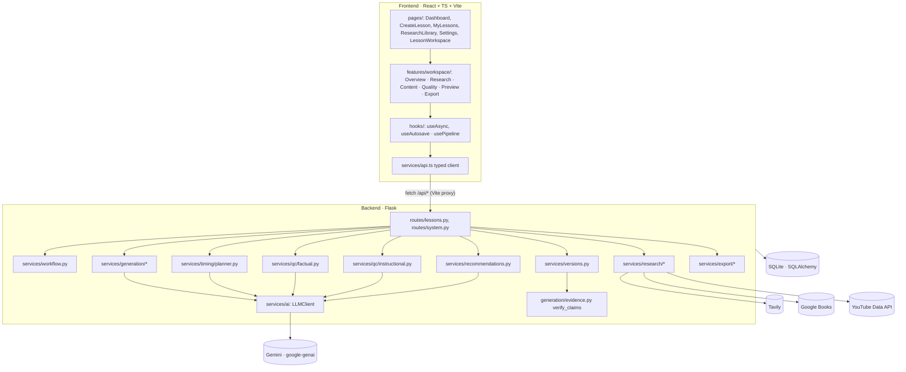
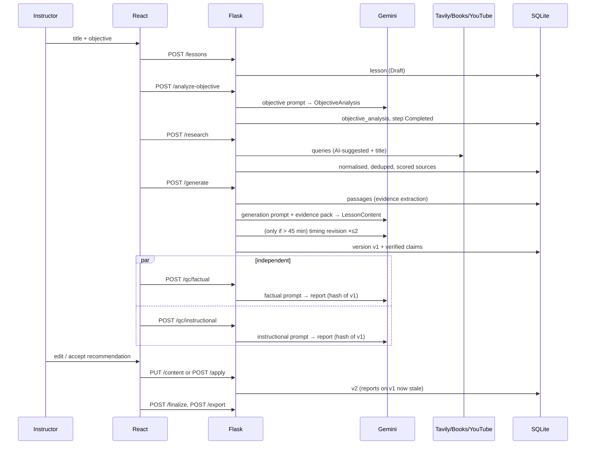

# LessonForge architecture

## 1. System overview

## 2. Frontend

- **Routing** (`App.tsx`): `/`, `/create`, `/lessons`, `/lessons/:id` (workspace, `?tab=` and `?run=1`), `/library`, `/settings`.
- **Layout**: a sticky sidebar on desktop and a drawer on mobile, with a skip link and visible focus rings.
- **Design system** (`components/ui`): Button, Badge, Card, Field (label, hint, error and counter wired with `aria-describedby`), inputs, Modal/ConfirmDialog (focus capture, Esc to close), Tabs (ARIA tabs with arrow-key navigation), Alert, EmptyState, Stat. Colour tokens are defined in `index.css` via Tailwind 4 `@theme`.
- **Data flow**: `LessonWorkspace` owns the `LessonDetail` returned by the API. Every mutating call returns the fresh lesson, which replaces local state, so the UI always reflects the persisted backend state.
- **`usePipeline`**: runs the stage endpoints in order and stops on the first failure (a QC failure does not stop the other QC). The only client-side progress state is "which request is in flight". Step statuses come from `workflow_executions`.
- **`useAutosave`**: 1.5 s debounce, single in-flight save with queued follow-ups, a draft mirrored to `localStorage` until the server confirms, and states `dirty / saving / saved / error`. If a save fails, the draft remains and is offered for restore on the next visit.
- **Secrets**: none. The API base is the relative path `/api`.

## 3. Backend

- **App factory** (`app/__init__.py`): loads settings, initialises the DB, registers blueprints, and adds JSON error handlers for AppError, Pydantic errors, SQLAlchemy errors, 404/405/413 and a catch-all. Stack traces are never sent to clients; logs go to stdout.
- **Settings**: read from env/`.env`. `public_status()` exposes only whether keys are present.
- **Errors** (`utils/errors.py`): `ValidationFailed` 422, `NotFound` 404, `Conflict` 409, `MissingCredentials` 503, `ExternalServiceError` 502, `RateLimited` 429, `AIOutputInvalid` 502, `TimingLimitExceeded` 422.
- **HTTP helper** (`utils/http.py`): timeout per request, up to 2 retries with exponential backoff for timeouts, network errors, 429 and 5xx. 401/403 map to "invalid credentials" immediately. Query strings are never logged.
- **Stage execution** (`routes/lessons.py::_run_stage`): guard against double-running → `start_step` (Running, or Retrying after a failure, with `retry_count`) → stage function (commits its own results) → `complete_step`. On an exception, `fail_step` rolls back only the uncommitted writes and records the failure in a clean transaction. Earlier stages' committed results are untouched.

## 4. Database

See the table in README.md. Notes:

- `lesson_versions.content` holds the **entire** lesson document (sections, questions, claims, reference IDs). This makes versions self-contained and restorable.
- `claims` mirrors the claims of each version for querying.
- `content_hash` (SHA-256 of canonical JSON) is the single mechanism behind staleness. A report is fresh if and only if its hash equals the current version's hash.
- `workflow_executions` has a unique `(lesson_id, step_name)` constraint, so retries update one row.
- `research_sources` has unique `(lesson_id, source_key)` and `(lesson_id, dedupe_key)` constraints, so reruns cannot duplicate sources or renumber them.

## 5. External services

| Service | Module | Auth | Failure behaviour |
|---|---|---|---|
| Gemini | `services/ai/client.py::GeminiClient` | `GEMINI_API_KEY` | 429 → RateLimited (retried), 401/403 → invalid credentials, 404 → bad model name, timeouts/5xx retried, empty/blocked response → error |
| Tavily | `research/providers.py::TavilyProvider` | Bearer token | Missing key stops further queries; other providers continue |
| Google Books | `GoogleBooksProvider` | optional `key` param | as above |
| YouTube | `YouTubeProvider` | `key` param | The duration lookup (`videos.list`) is optional; search results are kept if it fails |

## 6. Data flow for one lesson

## 7. Offline demo components

`app/demo/`: `demo_research.py` provides providers built on fixture text captured from real documentation. `demo_llm.py` is a deterministic stand-in implementing the same `generate_json` interface. `lessons.py` holds the fixture analysis and lessons. Because these swap in at the same seams as the real clients (`get_llm()`, `get_providers()`), every route, verifier, timing rule, QC post-processor and export runs exactly as in live mode.
